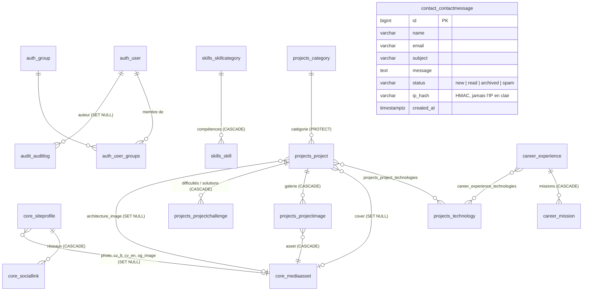

# Base de données

PostgreSQL 16, schéma géré exclusivement par les migrations Django (`backend/apps/*/migrations/`). Le fichier [`schema.sql`](schema.sql) est un export de référence du schéma obtenu.

**Initialisation**

```bash
python manage.py migrate            # crée toutes les tables, contraintes et index
python manage.py createcachetable   # table de cache (limitation de débit partagée)
python manage.py seed_placeholders  # catégories de base (+ --with-samples pour des exemples identifiés)
python manage.py create_portfolio_admin --username … --email …
```

En production, deux rôles : le **propriétaire** (migrations) et le **rôle applicatif** (`SELECT/INSERT/UPDATE/DELETE` uniquement), créés par `deploy/docker/postgres-init/01-roles.sh`.

## Modèle relationnel



## Tables

Toutes les tables métier ont `id` (BigAutoField), `created_at` et `updated_at`. Les contenus publiables ont `is_published` et `display_order`.

| Table | Rôle | Contraintes et index notables |
|---|---|---|
| `auth_user`, `auth_group`, `auth_permission` | Administrateurs (Django). Le groupe `portfolio_admins` porte les permissions des applications du portfolio | Hachage Argon2id ; aucune création via l'API |
| `core_siteprofile` | Informations générales (singleton) : identité, présentation, à propos, vision, centres d'intérêt, approche, ambitions, SEO, fichiers | `CHECK (singleton = 1)` + `UNIQUE(singleton)` |
| `core_sociallink` | Réseaux professionnels | FK profil ; index `(profile, display_order)` ; URL https publique |
| `core_mediaasset` | Fichiers téléversés (images ré-encodées, PDF) | Clé UUID ; index `(kind, folder)` ; chemins générés par le serveur |
| `projects_category` | Catégories de projets (filtres) | `slug` unique |
| `projects_technology` | Technologies | `name` et `slug` uniques |
| `projects_project` | Projets : carte + chapitres contexte, problématique, objectifs, fonctionnalités, architecture (texte + schéma), résultats | `slug` unique ; FK catégorie `PROTECT` ; `CHECK (ended_on >= started_on)` ; index `(is_published, display_order)`, `(category, is_published)` |
| `projects_project_technologies` | Projets ↔ technologies | `UNIQUE(project, technology)` |
| `projects_projectimage` | Captures (chapitre 07 de la page projet) | Index `(project, display_order)` |
| `projects_projectchallenge` | Paires difficulté / solution (chapitre 08) | FK `CASCADE` ; ordre `display_order` |
| `skills_skillcategory` | Catégories de compétences : frontend, backend, fullstack, databases, systems, devops, data, security, tools, other | `slug` unique |
| `skills_skill` | Compétences (niveau facultatif) | `UNIQUE(category, name)` ; index `(category, is_published, display_order)` |
| `career_experience` | Emplois, stages, alternances, freelance | `CHECK (end_date IS NULL OR end_date >= start_date)` ; index `(is_published, -start_date)` |
| `career_mission` | Missions d'une expérience | FK `CASCADE` |
| `career_education` | Formations et diplômes | `CHECK` sur l'ordre des dates |
| `career_certification` | Certifications | `CHECK (expires_on IS NULL OR expires_on >= issued_on)` |
| `career_achievement` | Réalisations (prix, publications, contributions…) | URL https publique facultative |
| `contact_contactmessage` | Messages reçus | Index `(status, -created_at)` |
| `audit_auditlog` | Journal d'audit | Index `(actor, -created_at)`, `(action, -created_at)` |
| `axes_*` | Tentatives de connexion et verrouillages (django-axes) | Gérées par la bibliothèque |
| `django_session` | Sessions serveur | — |
| `portfolio_cache` | Cache partagé (limitation de débit) | Créée par `createcachetable` |
